<div align="center">

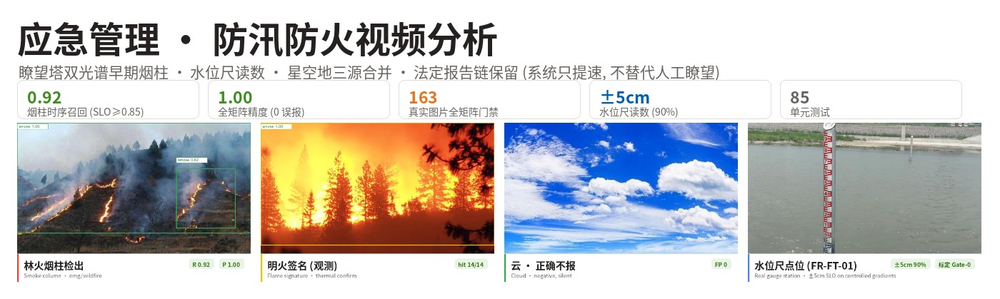

**林草火险 + 防汛防台视频分析：瞭望塔双光谱早期烟柱 · 水位尺读数 · 星空地三源合并。零漏报纪律与误报预算全部工程化。**


<!-- 发布时将 OWNER/REPO 替换为实际仓库路径, 并将 ci.yml 复制到 .github/workflows/ci.yml -->


**[English](README_en.md)** | 简体中文

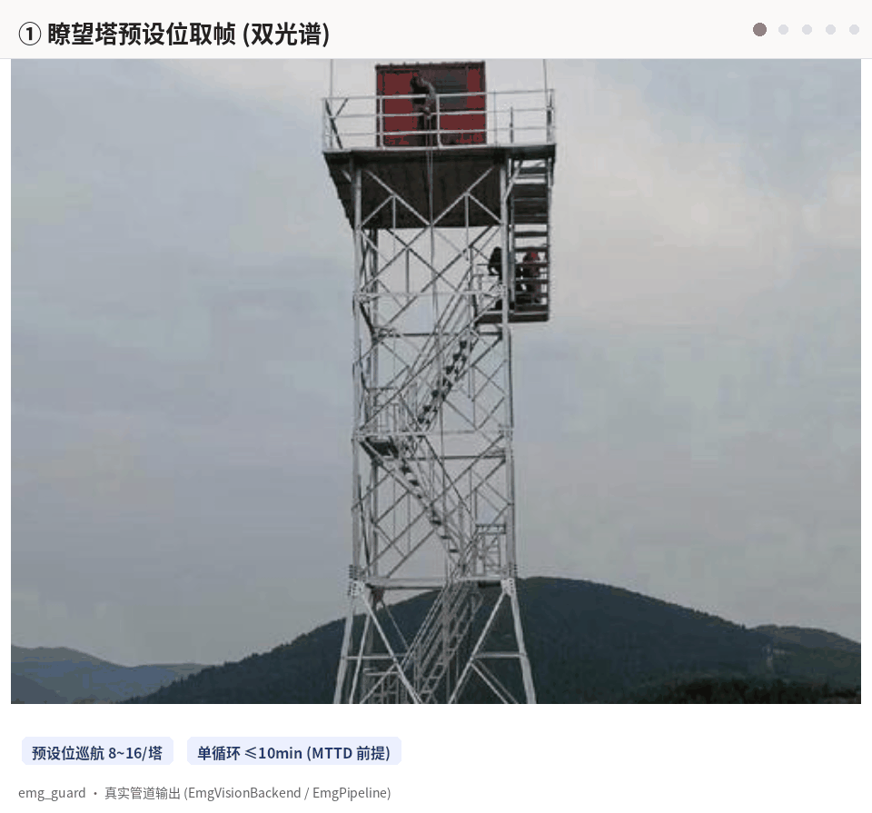

*图：瞭望塔处理流程（真实管道输出）——合成烟柱序列经可见通道检出后，时序三特征（升起/增长/持续）三取二确认，AI-Reference 二段确认与计划烧除白名单消歧，最终产出 `emg/wildfire` 线索。可见通道单光谱只产"疑似烟"（risk 3），双光谱交叉才直推值班（risk 4）。*

</div>

---

## 1. 背景与挑战

面向森防指/防汛办/应急局的早期灾情发现系统，服务对象的工作方式是
"一年可能零火情，但一次漏报就是灾难"。这个域的结构性困难与前九类
安防场景完全不同：

| 挑战 | 现状描述 |
|------|---------|
| 事件极低频 | 单塔一年可能零火情——没有持续正样本流，"上线后自己学"无从谈起 |
| 漏报代价极高 | 早期烟（<10min）是扑救窗口；漏报的代价是灾损，不是 KPI |
| 误报的代价是信任 | 云/雾/晨霭/扬尘/工业白烟都是可见烟柱的光学近亲——"狼来了"三次，值班员就关掉推送 |
| 法定报告链 | 森林防火条例的火情报告制度是人工职责——系统不能替代，只能提速 |

## 2. 设计重心（范围先行）

**发现算法不是难点**（烟雾/水位是成熟技术），难点在误报治理与漏报
纪律的工程化。三条第一原则：

1. **双光谱融合压误报**：可见光烟柱误报天敌是云/雾/晨霭/扬尘——热成像
   热点与可见烟柱交叉确认是瞭望塔路线的立身之本。可见通道单光谱只产
   "疑似烟"（推送瞭望员复核），烟×热时空交叉才直推值班（risk 4）。
2. **零漏报纪律**：受控火源摆拍全集合零漏报为一票否决项；检测器的失败
   方向必须是 fail-safe——近距密烟（面积超全帧 55%）与地面相连时**保留
   观测降级推送**，只有不与地面相连的云雾才剔除。
3. **法定报告链保留**：系统告警 → 瞭望员/值班复核 → 法定报告。系统是
   提速手段，不替代人工瞭望，不做对外预警发布（发布权在应急管理部门）。

**范围外声明**：夜间/浓雾下的可见光烟柱发现能力有限——以双光谱热通道
为兜底（设计 §8.6 期待管理条款，甲方签认）；危化品泄漏/地质灾害/大面积
停电三个 T4 事件**不设视频检测**——判定权在监测体系，视频只做调帧佐证
且不改变定级（FR-DS）。

## 3. 三模型流水线

| 模型 | 职责 | 回答的问题 |
| --- | --- | --- |
| AI-Detect（烟柱/热斑检出：可见色度+热像温升基线，开放词汇检测可插拔增强，正式路径为林火烟样本微调 §4.1） | L1 发现 | "画面里有从林冠线升起的烟团吗？热像帧里有升温斑点吗？" |
| AI-Recognize（时序身份追踪 + 双光谱时空配对） | L2 确认 | "还是上个巡航周期那团烟吗？升起/增长/持续齐了吗？烟与热斑是同一目标吗？" |
| AI-Reference（Qwen3VL grounding） | 裁决 | "那真的是从地面升起的林火烟柱——还是云、雾、晨霭或工业白烟？" |

三件套是流水线，不是三个孤岛：**可见证据与热证据互补而非冗余**——阴燃
初期密烟可见剧变但热特征未起（可见高、热低），白昼岩石/太阳直射热斑
热特征显著但无烟（热高、可见低），只有真火情双高；EmgPipeline 把这条
规律写成显式三档真值表（fusion 烟×热交叉→risk4 直推值班 / smoke_only→
疑似烟复核 / thermal_only→不推），任何单通道都不能单独直达值班。
单帧色度判别烟/云/雾实测天花板 0.35（如实量化，正是设计 §1.3 的立论）
——"检出但单帧形态含糊"的分支交给 L2 的时序三特征（升起/增长/持续，
三取二）与 AI-Reference 裁决定型（标准问句 + 证据帧取证），瞭望员
确认记录是金标准。可见/热像通道独立值守，任一通道失效降级不失效
（热像标定过期仅降级热通道）。

防汛域注：水位尺读数/淹没分级复用生命线域引擎（±5cm；逼近警戒/越警戒/
越保证 = risk 2/3/4 阶梯），不走三件套。

## 4. 技术亮点

- **时序三特征是可见通道的可靠判定面**——单帧色度判别烟/云/雾实测不可靠
  （P1 观测 acc 0.35，如实报告并作为设计立论），可靠的是跨巡航周期的
  升起/增长/持续三取二。跨帧团块匹配门限按 30s 重访位移实测整定
  （0.15→0.25），快速抬升的烟柱不断身份。
- **密烟 fail-safe**（回归测试锁定）——旧实现把面积 >55% 帧的烟团当雾
  丢弃：近距大火烟占满画面时零产出。修复后按 FR-WF-05 本义判别：与地面
  点源相连即保留（降级为疑似烟推送），云/雾（不相连/全帧均匀）才剔除。
- **AI-Reference 二段确认真的在环**（回归测试锁定）——观测携带证据帧 → 执行器
  汇总 → AI-Reference 问句取证送审；否决不终结发作期，冷却后重试
  （fail-operational），VLM 一次误否决不会吞掉整场火情。
- **计划烧除白名单三态**（FR-COM-03）——审批单（多边形+时段+责任人）
  导入即生效：窗口内零告警但留痕；超时/超范围（任一烟柱框越界）100%
  告警。有专项测试锁定三个状态。
- **星空地三源合并**——瞭望塔视频 + 卫星热点（I/S）+ 地面巡护上报（S，
  上报人脱敏）在平台分钟桶合并互证；卫星热点与塔位 Haversine 邻近比对
  作为告警佐证字段。
- **健康 fail-loud 分级降级**——塔台断链/云台失步/镜头污损全通道降级 +
  告警；热像标定过期仅降级热通道（可见通道继续值守，§8.5）；未登记
  点位零产出 + 限频运维线索。
- **重启不丢状态**——点位/事件/白名单台账 + 审计链 + outbox 全量 SQLite
  落库；证据（烟柱序列 3 帧 + 热像图 + 交会定位图）留存 ≥1 年（火案调查）。

## 5. 效果图

以下标注均为真实管道输出（`EmgVisionBackend` 对 163 张百度真实图数据集
的实际运行，未经手工修改）。

真实检出与正确不报（正确不报 = 系统的另一半能力）：

| 林火烟柱检出 | 明火签名（观测） | 密烟保留 |
|:---:|:---:|:---:|
| 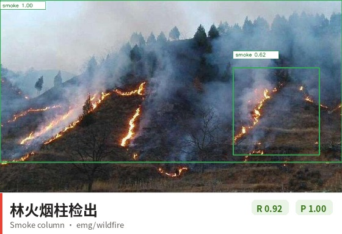 | 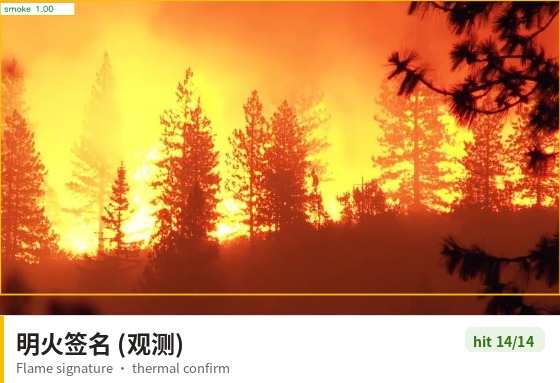 | 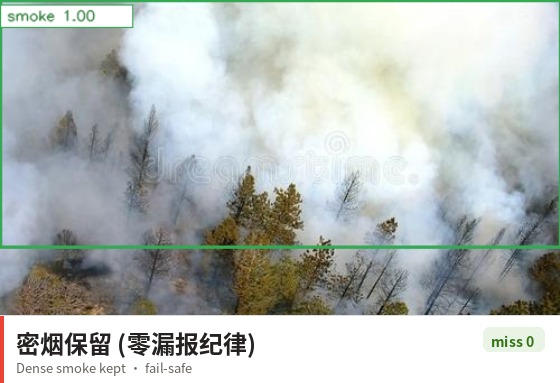 |
| **云 · 正确不报** | **晨雾 · 正确不报** | **工业白烟 · 时序+终审** |
|  | 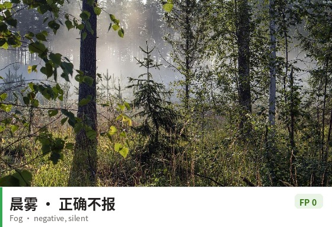 | 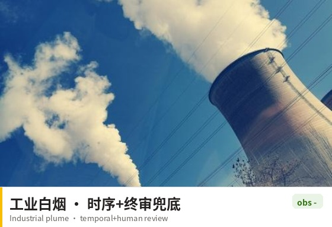 |

防汛域（水位尺为真实点位照片；±5cm 达标率在 60 组受控梯度上验收，真实点位读数需 Gate-0 逐点标定）：

| 水位尺点位 (FR-FT-01) | 城市内涝（观测） |
|:---:|:---:|
| 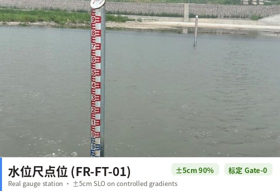 | 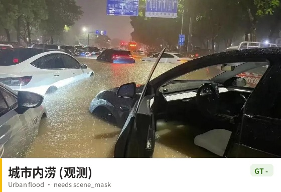 |

总览：

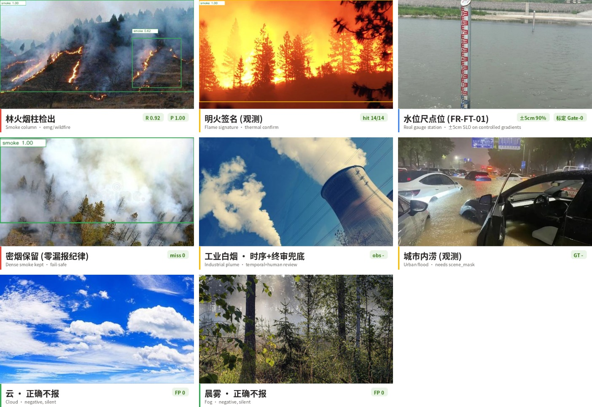

## 6. 端到端流程示例

以一次瞭望塔巡航为例（时间为示意，判定与路由为真实逻辑）：

| 时刻 | 环节 | 说明 |
|------|------|------|
| 09:00:00 | 预设位 3 取帧 | 单循环 ≤10min，双光谱同帧（可见+热像） |
| 09:00:00.3 | 首帧检出 | 可见通道检出烟团 score 0.8，from_ground=True；仅 1 特征不足三取二，不产候选 |
| 09:00:30 | 下一循环复检 | 同一团块匹配成功：rise=True（质心上移）、grow=True（面积 2.1×）、persist=True |
| 09:00:30.2 | 白名单核对 | 该点位无在效审批单 → 不抑制；时序确认窗（confirm_s 30s）满足 |
| 09:00:30.3 | AI-Reference 复核 | 标准问句"是否有从地面升起的林火烟柱" + 证据帧 → 通过 |
| 09:00:30.5 | risk3 线索 | `emg/wildfire_suspected_smoke` 推送瞭望员复核（单光谱不直推值班） |
| 09:01 | 热像交叉 | 预设位 3 热像帧同区域检出热斑 ΔT 12K → fusion 档 risk 4 直达森防指值班 ≤1min |
| 09:01+ | 双塔交会 | 通视塔对同目标方位角解算 → 火点经纬度（≤500m，待试点标定验收） |
| 汛期 | 防汛联动 | 气象预警 → 水位尺点位升频 1~5fps；越警戒 risk3、越保证 risk4 直达防汛办 |

## 7. 关键指标

基准口径：**163 张百度真实图（v2 数据集，与 v1 全量内容哈希去重），
烟柱素材 × 全部 12 张瞭望塔背景全矩阵合成时序（消除单背景过拟合）+ 云/
雾静帧负样本 + 受控水位梯度**，端到端过 `WildfireTowerEngine`。
详见 [CHANGELOG](../../emg_guard/CHANGELOG.md) 与数据集
[MATERIAL_ADMISSION.md](../../demo_outputs/emergency_image_test_v2/MATERIAL_ADMISSION.md)。

| 协议 | 实测 | SLO (§5.1) | 结论 |
|------|------|------------|------|
| P2 烟柱时序端到端 R / P | **0.923 / 1.00** (144/156, FP 0/24) | ≥0.85 / ≥0.75 | ✓ |
| P3 水位尺读数 ≤±5cm | **0.90** (54/60 受控梯度) | ≥0.90 | ✓ |
| G1 计划烧除白名单 | 窗口内 0 告警+留痕，窗口外/多边形外全告警 | 三态全对 | ✓ |
| P1 单帧烟柱消歧（观测） | acc 0.35 | 不判分 | 设计以时序+融合+终审兜底 |

| 指标 | 数值 | 口径 |
|------|------|------|
| 修复轨迹 | 新图旧协议 R 0.92→0.00 塌落 → 根因修复 → 全矩阵 0.923 | 协议去过拟合 + 匹配门限 + 素材真值治理 |
| 工程质量 | 85 个单元测试（含 6 项回归锁） | 无 GPU 环境全量运行 |
| 门禁 | CI: 单测 + 163 图全矩阵图片门禁 | 数据集未分发时自动跳过 |
| 三源合并 | 视频+卫星+巡护 分钟桶，HMAC 签名推送 | 平台语义复用 |

> **诚实口径**：组件级回归（网络图片 + 合成时序协议），证明能力而非生产
> 验收。热像链路无真实热像数据实测；双塔交会 ≤500m 待 GPS 打点对照；
> 真实内涝色度分割泛化差（需 Gate-0 scene_mask 标定）。设计 §8.2 的验收
> 基准（受控燃火摆拍 ≥80 次 + 负样本 ≥300 段 + 30 天试运行）尚未建设。

## 8. 快速开始

```python
import cv2
from emg_guard.examples import build_sample_registry
from emg_guard.engine import WildfireTowerEngine
from emg_guard.vision import EmgVisionBackend, EmgVisionConfig

reg, points, wl = build_sample_registry()
engine = WildfireTowerEngine(
    "TOWER-A", points, reg, wl,
    backend=EmgVisionBackend(EmgVisionConfig()))

# visible=可见帧; ctx 注入: thermal_frame=热像帧 / azimuth_deg=云台方位 /
# frame_ref=帧存档引用(AI-Reference 取证) / satellite_hotspots / patrol_reports
clues = engine.process(cv2.imread("tower_p3.jpg"),
                       thermal_frame=None, azimuth_deg=135.0,
                       frame_ref="store://frames/f1.jpg")
# → emg/wildfire* 线索 (fusion risk4 直推 / smoke_only risk3 复核)
```

```bash
# 163 图全矩阵图片基准 (CI 门禁, CPU ~20s)
python -m emg_guard.bench_images \
    --images demo_outputs/emergency_image_test_v2

# 单元测试 (85 项, 无 GPU)
python -m pytest emg_guard/tests -q

# 瞭望塔/防汛点位轮巡服务 (场景注册后轮巡/推送/AI-Reference 问句自动生效)
python -m emg_guard.runner --config emg_guard/deploy/config.example.json
```

## 9. 系统架构

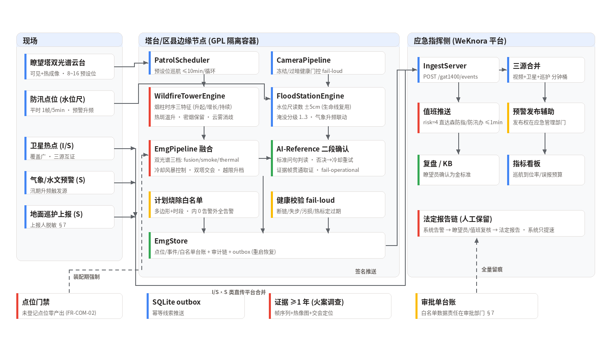

## 10. 范围与限制

- **热像链路未实测**：温升阈值/融合 fusion 档/标定过期降级逻辑有单测，
  但从未在真实热像数据上验证——设计 §5.1 "热斑检出 ≥95%" 需受控燃火
  摆拍（专业防火队伍执行，§8.2 安全条款）。
- **双塔交会定位未验收**：方位射线求交几何有单测，但方位角来源（云台
  标定+DEM 解算）依赖试点工程；≤500m 验收需 §8.2 GPS 打点对照 ≥30 点。
- **单帧烟柱判别天花板**：色度规则单帧 acc 0.35——可靠判定面是时序
  三特征；正式达标路径是公开林火烟数据集微调（设计 §4.1"模型需林火烟
  样本微调"，训练体系在 AI-Detect 主仓库）。
- **真实内涝分割泛化差**：城市浑浊水与路面色度重叠，观测覆盖率 ~0.002
  ——淹没分级需点位 scene_mask + 水文站双源标定（Gate-0）。
- **网络图片 ≠ 生产验收**：本基准证明工程能力；§8.2 验收基准（受控燃火
  80 次、负样本 300 段、30 天影子运行）需试点合作建设。

## 11. License 与数据声明

代码为商业软件（Commercial Software），未经授权不得复制、修改、分发或
商用。基准图片来自百度图片搜索，**不随仓库分发**；`fetch_emg_images_v2.py`
提供可复现抓取（标注仅供研究），`results/metrics.json` 与评估报告随仓库
提供。烟柱正例素材准入规则（白昼可见烟柱；夜火/明火素材归位热像/明火
通道协议）见 `MATERIAL_ADMISSION.md`。系统仅在应急管理部门主导的场景
部署；系统告警不替代法定火情报告链，不做对外预警发布。
