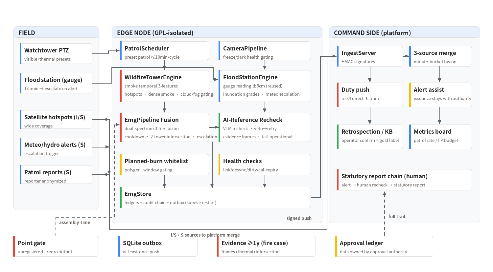

<div align="center">


**Wildfire + flood/typhoon video analytics: dual-spectrum watchtower early-smoke detection · water-gauge reading · sky-space-ground three-source fusion. Zero-miss discipline and false-alarm budgets, enforced in code.**


[](https://github.com/hi-agi-lab/AutoVision)
[](https://pypi.org/project/autovision-framework/)

English | **[简体中文](README.md)**


*Figure: watchtower flow (real pipeline output) — a synthetic rising-smoke sequence is detected by the visible channel, confirmed by the temporal 3-features (rising / growing / persisting, 2-of-3), gated by AI-Reference recheck and the planned-burn whitelist, and emitted as an `emg/wildfire` clue. Single-spectrum visible-only yields "suspected smoke" (risk 3); visible×thermal cross-confirmation is what dispatches straight to the duty terminal (risk 4).*

</div>

---

## 1. Background & Challenges

An early-discovery system for forestry-fire and flood command centers. The
operating reality is unlike any other video-surveillance domain: **a tower
may see zero fires for a whole year, and one miss is a disaster.**

| Challenge | Current state |
|------|---------|
| Extremely rare events | No continuous positive stream — "learn it after deployment" is a non-starter |
| A miss is catastrophic | Smoke under 10 minutes is the suppression window; the cost of a miss is the fire, not a KPI |
| False alarms destroy trust | Clouds / fog / morning haze / dust / industrial plumes are all optical cousins of smoke — three "wolf cries" and operators mute the feed |
| Statutory reporting chain | Fire reporting is a human legal duty — the system may accelerate it, never replace it |

## 2. Design Priorities (scope first)

**Detection is not the hard part** (smoke and water gauges are mature
technology). The hard part is engineering false-alarm governance and
miss discipline:

1. **Dual-spectrum fusion suppresses false alarms** — clouds/fog/haze/dust
   are the visible channel's natural enemies; cross-confirming a visible
   smoke column with a thermal hotspot is the whole point of the watchtower
   route. Visible-only yields "suspected smoke" for operator review;
   smoke×thermal spatio-temporal cross-hit dispatches at risk 4.
2. **Zero-miss discipline** — a controlled-burn set with zero misses is a
   veto criterion. The detector must fail safe: dense close-range smoke
   (>55% of frame) connected to the ground is **kept and degraded to a
   suspected-smoke push**; only clouds/fog (not grounded / whole-frame
   uniform) are dropped. Regression-tested.
3. **Statutory chain preserved** — system alert → tower operator recheck →
   statutory report. The system accelerates; it does not replace human
   watch, and it never issues public alerts (that authority sits with the
   emergency management agency).

**Out of scope**: night/dense-fog visible smoke detection (thermal channel
is the fallback — an expectation-management clause signed by the customer);
hazmat leak / geological hazard / blackout are **sensor-authoritative T4
events with no video detection FR** — video only fetches corroborating
frames and never re-grades the sensor's decision (FR-DS).

## 3. The Three-Model Pipeline

| Model | Role | Question it answers |
| --- | --- | --- |
| AI-Detect (smoke/hotspot detection: visible color + thermal ΔT baseline, open-vocabulary detection pluggable, formal path is wildfire-smoke fine-tuning §4.1) | L1 discovery | "Is there a blob rising from the canopy line? Any warm spot in the thermal frame?" |
| AI-Recognize (temporal identity tracking + dual-spectrum pairing) | L2 confirmation | "Is this the same plume as last patrol cycle? Are rising/growing/persisting satisfied? Do smoke and hotspot belong to one target?" |
| AI-Reference (Qwen3VL grounding) | Adjudication | "Is that really a wildfire smoke column rising from the ground — or cloud, fog, morning haze, an industrial plume?" |

The three are a pipeline, not three islands: **visible evidence and thermal
evidence complement rather than duplicate each other** — early-stage
smoldering shows dramatic visible smoke but little thermal signal
(visible-high, thermal-low); daytime rocks and sun-lit roofs show strong
thermal but no smoke (thermal-high, visible-low); only a real fire is high
on both. EmgPipeline writes this law down as an explicit three-tier truth
table (fusion: smoke×thermal cross-hit → risk4 direct dispatch /
smoke_only → operator review / thermal_only → silent) — no single channel
can reach the duty terminal alone. Single-frame color discrimination of
smoke/cloud/fog measures a 0.35 ceiling (quantified honestly — the very
argument of design §1.3); the ambiguous "detected but visually unclear"
branch goes to L2's temporal features (rising/growing/persisting, 2-of-3)
and to AI-Reference for adjudication (standard question + evidence frames),
with the tower operator's confirmation as the gold label. The visible and
thermal channels keep watch independently — either can degrade without
dropping the other (expired thermal calibration degrades only the thermal
channel).

Flood note: gauge reading / inundation grading reuse the lifeline-domain
engine (±5cm; approach/warning/guarantee = risk 2/3/4 ladder) — outside
the trio.

## 4. Technical Highlights

- **Temporal features are the visible channel's reliable surface** —
  single-frame color discrimination of smoke vs cloud vs fog measures 0.35
  accuracy (honestly reported as an observation, and the very reason the
  design leans on fusion + human review). What is reliable: rising /
  growing / persisting across patrol cycles, 2-of-3. The cross-frame blob
  matching gate is tuned from measured 30s-revisit displacement
  (0.15 → 0.25) so fast-rising plumes don't lose identity.
- **Dense smoke fails safe** (regression-locked) — the old code silently
  dropped blobs over 55% of frame: a close-range fire filling the view
  produced *zero* output. Fixed to FR-WF-05's actual semantics:
  ground-connected blobs are kept (degraded to suspected-smoke push);
  only ungrounded cloud/fog is dropped.
- **The AI-Reference recheck is really wired in** (regression-locked) — observations
  carry evidence-frame refs → executor aggregates them into the verdict →
  AI-Reference adapter submits them with a standard question. A veto no longer
  terminates the episode: the cooldown spaces a retry (fail-operational),
  so one VLM misjudgment cannot swallow the whole fire.
- **Planned-burn whitelist, three states** (FR-COM-03) — approval records
  (polygon + window + owner) take effect on import: zero alerts inside the
  window (with an audit trail); 100% alerts outside it or when any smoke
  box crosses the polygon. All three states have dedicated tests.
- **Sky-space-ground three-source fusion** — watchtower video + satellite
  hotspots (I/S) + patrol reports (S, reporter anonymized) merge in the
  platform's minute buckets; satellite proximity (Haversine) corroborates
  alerts as a structured field.
- **Graded fail-loud health** — link loss / gimbal desync / dirty lens
  degrade the full channel with an alert; expired thermal calibration
  degrades *only* the thermal channel (visible keeps watch, §8.5);
  unregistered points produce zero output plus a rate-limited ops clue.
- **Restart-safe** — point/event/whitelist ledgers + audit chain + outbox
  all in SQLite; evidence (3-frame smoke sequence + thermal image +
  intersection plot) retained ≥1 year for fire investigation.

## 5. Screenshots

All annotations are real pipeline output (EmgVisionBackend run on the
163-image Baidu dataset, no manual edits).

Real detections and correct silence (correct silence is the other half of
the capability):

| Smoke column detected | Flame signature (obs.) | Dense smoke kept |
|:---:|:---:|:---:|
|  |  |  |
| **Cloud · silent** | **Fog · silent** | **Industrial plume · temporal+human** |
|  |  |  |

Flood domain (gauge panel: real field gauge station; the ±5cm SLO is
validated on 60 controlled gradients — real points need Gate-0
per-point calibration):

| Gauge station (FR-FT-01) | Urban flooding (obs.) |
|:---:|:---:|
|  |  |

Montage:


## 6. End-to-End Walkthrough

One patrol cycle (times illustrative; decisions and routing are the real
logic):

| Time | Step | Notes |
|------|------|------|
| 09:00:00 | Preset 3 frame | Cycle ≤10min; dual-spectrum same frame (visible+thermal) |
| 09:00:00.3 | First detection | Visible channel: blob score 0.8, from_ground=True; only 1 feature < 2-of-3 → no candidate |
| 09:00:30 | Next cycle | Same blob matched: rise=True (centroid up), grow=True (area 2.1×), persist=True |
| 09:00:30.2 | Whitelist check | No active approval for this point → not suppressed; confirm window (30s) satisfied |
| 09:00:30.3 | AI-Reference recheck | Standard question + evidence frames → pass |
| 09:00:30.5 | risk3 clue | `emg/wildfire_suspected_smoke` → operator review (single spectrum never dispatches) |
| 09:01 | Thermal cross-hit | Same region hotspot ΔT 12K → fusion tier, risk 4 to the duty terminal ≤1min |
| 09:01+ | Two-tower fix | Bearing intersection → fire coordinates (≤500m, pending pilot calibration) |
| Flood season | Flood linkage | Meteo alert → gauge points escalate to 1–5fps; above warning risk3, above guarantee risk4 |

## 7. Key Metrics

Benchmark: **163 real web images (v2 dataset, content-hash deduplicated
against v1), smoke material × all 12 tower backgrounds full-matrix
synthetic temporal sequences (eliminates single-background overfitting) +
cloud/fog static negatives + controlled water-level gradients**, run
end-to-end through `WildfireTowerEngine`. See
[CHANGELOG](../../emg_guard/CHANGELOG.md) and the dataset's
[MATERIAL_ADMISSION.md](../../demo_outputs/emergency_image_test_v2/MATERIAL_ADMISSION.md).

| Protocol | Result | SLO (§5.1) | Verdict |
|------|------|------------|------|
| P2 temporal smoke end-to-end R / P | **0.923 / 1.00** (144/156, FP 0/24) | ≥0.85 / ≥0.75 | ✓ |
| P3 gauge reading ≤±5cm | **0.90** (54/60 controlled gradients) | ≥0.90 | ✓ |
| G1 planned-burn whitelist | 0 alerts in-window (+trace), all alerts out-of-window/out-of-polygon | 3/3 states | ✓ |
| P1 single-frame disambiguation (obs.) | acc 0.35 | not scored | by design: temporal+fusion+human |

| Metric | Value | Notes |
|------|------|------|
| Repair trajectory | 0.92 (old single-bg protocol) → 0.00 on fresh images → root-caused → 0.923 full-matrix | protocol de-overfit + matching gate + GT curation |
| Engineering | 85 unit tests (incl. 6 regression locks) | full run without GPU |
| Gate | CI: unit tests + 163-image full-matrix gate | auto-skipped if dataset not distributed |
| Three-source merge | video+satellite+patrol minute buckets, HMAC push | platform semantics reused |

> **Honest labeling**: component-level regression (web images + synthetic
> temporal protocol) — capability evidence, not production acceptance. The
> thermal chain has never seen real thermal data; two-tower ≤500m awaits
> GPS ground-truthing; real urban-flood segmentation needs Gate-0
> scene_mask calibration. Design §8.2 acceptance (controlled burns ≥80,
> negatives ≥300, 30-day shadow run) is not built yet.

## 8. Quick Start

```python
import cv2
from emg_guard.examples import build_sample_registry
from emg_guard.engine import WildfireTowerEngine
from emg_guard.vision import EmgVisionBackend, EmgVisionConfig

reg, points, wl = build_sample_registry()
engine = WildfireTowerEngine(
    "TOWER-A", points, reg, wl,
    backend=EmgVisionBackend(EmgVisionConfig()))

# visible frame; ctx injection: thermal_frame / azimuth_deg (PTZ bearing) /
# frame_ref (stored-frame ref for AI-Reference evidence) / satellite_hotspots /
# patrol_reports
clues = engine.process(cv2.imread("tower_p3.jpg"),
                       thermal_frame=None, azimuth_deg=135.0,
                       frame_ref="store://frames/f1.jpg")
# → emg/wildfire* clues (fusion risk4 direct / smoke_only risk3 review)
```

```bash
# 163-image full-matrix benchmark (CI gate, CPU ~20s)
python -m emg_guard.bench_images \
    --images demo_outputs/emergency_image_test_v2

# Unit tests (85, no GPU)
python -m pytest emg_guard/tests -q

# Watchtower/flood patrol service (scene registration wires scheduling,
# push, AI-Reference questions)
python -m emg_guard.runner --config emg_guard/deploy/config.example.json
```

## 9. Architecture



## 10. Scope & Limits

- **Thermal chain unverified on real data**: threshold/fusion/cal-expiry
  logic is unit-tested but has never seen a real thermal frame — §5.1's
  "hotspot detection ≥95%" requires controlled burns by a professional
  fire crew (§8.2 safety terms).
- **Two-tower positioning not accepted**: bearing-intersection geometry is
  unit-tested, but bearings come from PTZ calibration + DEM (pilot
  engineering); ≤500m acceptance needs ≥30 GPS ground-truth points.
- **Single-frame ceiling**: color-rule single-frame acc is 0.35 — the
  reliable surface is temporal; the formal path is fine-tuning on public
  wildfire-smoke datasets (design §4.1; training stack in the AI-Detect
  main repo).
- **Real flood segmentation generalizes poorly**: turbid urban water vs
  road overlap, observed coverage ~0.002 — inundation grading needs
  per-point scene_mask + hydrology dual-source calibration (Gate-0).
- **Web images ≠ production acceptance**: this benchmark evidences
  engineering capability; §8.2 acceptance needs a pilot.

## 11. License & Data

Commercial software; no copying, modification, distribution or commercial
use without authorization. Benchmark images come from Baidu image search
and are **not redistributed**; `fetch_emg_images_v2.py` reproduces the
crawl (labels for research only); `results/metrics.json` and reports ship
with the repo. Positive-material admission rules (daylight visible smoke;
night-fire/flame material belongs to the thermal/flame protocol) are in
`MATERIAL_ADMISSION.md`. Deploy only in emergency-authority-led programs;
system alerts do not replace the statutory fire-reporting chain and are
never public warnings.

---

The detection backbone, streaming inference runtime, and export chain of this solution are provided by the open-source framework [AutoVision](https://github.com/hi-agi-lab/AutoVision) (`pip install autovision-framework`); see the [integration design](https://hi-agi-lab.github.io/AutoVision/ecosystem/) for details.
